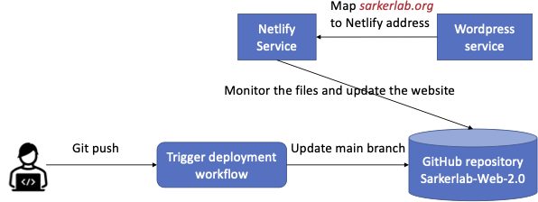

# Sarker lab website

This website is built with [Jekyll](https://jekyllrb.com/).
It is derived from the template at [ericdaat/research-lab-website](https://github.com/ericdaat/research-lab-website), originally provided by the
[Allan Lab](https://www.allanlab.org/aboutwebsite.html), at Leiden University.

## How the website is hosted
The website is not using Github Pages, and we use `Netlify` to host the website.
The `Netlify` service keeps monitoring the main branch. If there is any change, it will trigger the `Netlify` service to rebuild the website.
Similarly to Github Pages, the `Netlify` service gives a default domain name to the website like `xxxnetlify.com`.
We maps the default address to our website domain name `sarkerlab.org` via `Wordpress`, which is the domain provider.
The overall workflow is as below:


## Setup

``` bash
brew install ruby
gem install bundler jekyll
```

* If you use Mac, you may meet the problem of failing to write the Ruby directory.
That is because Mac does not allow the user to modify its original Ruby even with a root account.
One solution is to use `conda` to create an independent dev environment for the website development.
This way you may need to run `conda install ruby` instead of `brew install ruby`.
* If you can not solve the problem, try to follow the steps in this [blog](https://www.moncefbelyamani.com/how-to-install-xcode-homebrew-git-rvm-ruby-on-mac/).

Clone this repository, then install the dependencies.
``` bash
bundle install
```

## Test the website locally

It is a good practice to test your modification locally before pushing the code to the remote branch.
Run the local web server with:

``` bash
bundle exec jekyll serve --baseurl=""
```


If the website is successfully launched, you should see the following logs in your terminal.
Enter the address `http://127.0.0.1:4000/` to the broswer to open the website.
```
 Auto-regeneration: enabled for '/Users/gyt/Sarkerlab-Web-2.0'
    Server address: http://127.0.0.1:4000/
  Server running... press ctrl-c to stop.
```

## Update the website
Usually we need to regularly update the pages of `team`, `research`, and `publication`.
All the related files are put in the folders starting with `_`.
For example, the team member introductions are put in `_pages/team/_posts`.
The folder `image` is the only exception, where stores the images used in the website.
The left of this section introduces the specific steps of updating the website.

### Add/edit a team member

New members are stored as markdown files under
[_pages/team/_posts](_pages/team/_posts).

Each new member `.md` file must look like this:

``` yaml
---
layout: member
category: Team-Memebers
title: Researcher Name
image: researcher.png
role: Lab Director
permalink: 'team/researcher-name'
social:
    twitter: https://twitter.com/
    linkedin: https://www.linkedin.com/
    google-scholar: https://scholar.google.fr/
    github: https://github.com/
    website:
    orcid: https://orcid.org/
    research-gate: https://www.researchgate.net/
---

Add more detials here.
```

### Add/edit research projects

Research projects are stored as markdown files under
New members are stored as markdown files under
[_pages/research/_posts](_pages/research/_posts).
Each `.md` file must look like this:

``` yaml
---
layout: default
title: research project title
cover: image-for-the-project.png
description: a short introduction.
weight: 3
category: blog
---


Add more detials here.
```

`weight` decides the order of the articles shown at the research page.
The article with the smallest weight would be shown at the top.


<strong>Note for all the markdown files under `_posts` must be named following the format of `year-month-day-xxx` 
such as `2022-10-05-breast-cancer.md`. </strong>


## Troubleshooting
* What if the website is not updated after I pushed my changes?
There are several possible reasons that may cause this problem.
Try the following ways.
1) clear the brower cache and re-launch the website;
2) check the `Action` page and make sure that there is no errors in the new website code you pushed;
3) check the Netlify service is working correctly;
